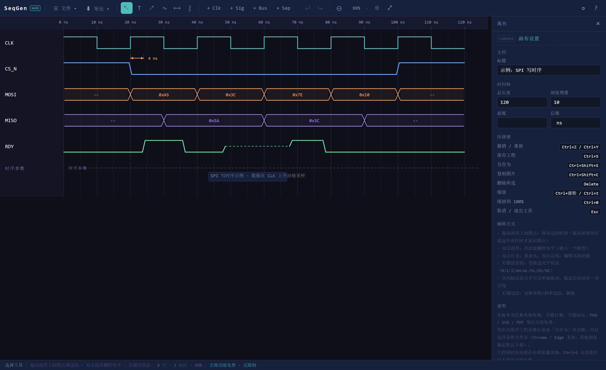

# SeqGen Web

**在浏览器里画数字时序图的单文件工具。** 零依赖、无需安装、不用编译——双击 `index.html` 就能用。



<sub>浅色主题见 [assets/screenshot-light.png](assets/screenshot-light.png)</sub>

---

## 特性

- **纯前端单页**：只有 3 个源文件，无 npm、无打包、无后端，离线可用
- **时钟 / 信号 / 总线 / 分隔行** 四种行类型，行数不限
- **波形直接编辑**：拖动边沿节点改时刻、双击翻转电平、右键选状态
- **8 种电平状态**：`1` `0` `Z`（高阻） `WH` `WL`（弱驱动） `HL`（冲突） `GV` `GC`（毛刺）
- **总线**：不确定态交叉标记、自定义每段文本、纯色 / 斜线 / 交叉线填充
- **时长标注**：Setup / Hold 区间线、双向箭头、自动计算时间差
- **时间断点**：在任意时刻打断波形，表示省略的时间
- **导出** PNG / SVG / PDF，或直接复制图片到剪贴板
- **5 套配色**：靛青、石墨、藏蓝、纯黑、浅色
- **全程可撤销**，工程文件是纯 JSON，也可自动保存在浏览器本地

## 快速开始

```bash
git clone https://github.com/<your-name>/seqgen-web.git
cd seqgen-web
```

然后 **直接双击 `index.html`**（或拖进浏览器）即可，不需要任何服务器。

如果你习惯用本地服务器：

```bash
python -m http.server 8000
# 打开 http://localhost:8000
```

首次打开点 **文件 → 载入示例**，可以看到一张完整的 SPI 写时序图照着改。

## 界面

```
工具栏  文件 / 导出 / 工具 / 加行 / 撤销 / 缩放 / 主题
──────────────────────────────────────────────────────
        左：画布（时间标尺 + 波形）      右：属性面板
        时钟、信号、总线、分隔行              跟随当前选中对象
──────────────────────────────────────────────────────
状态栏  行数 · 标注数 · 缩放比例 · 当前操作提示
```

左侧是画布，右侧属性面板会跟着你的选中对象变化——选行就改行，选边沿就改边沿，选标注就改标注。

## 使用指南

### 1. 添加行

工具栏 `+ Clk` `+ Sig` `+ Bus` `+ Sep` 分别添加时钟、信号、总线、分隔行。

- **时钟**：周期、占空比、相位、反相、上升/下降沿参考线与箭头、差分输出
- **信号**：边沿序列 + 初始电平，可选理想边沿（垂直）、差分（虚线镜像）、允许毛刺
- **总线**：按时间段分段，每段一个值
- **分隔行**：分组标题 + 虚线/实线/无

行高、颜色、名称都在右侧属性面板里改。行的顺序在**右键菜单**里用「上移 / 下移」调整，信号行还能一键「反转 0↔1」。

### 2. 编辑信号波形

| 操作       | 效果                                             |
| -------- | ---------------------------------------------- |
| 拖动波形上的圆点 | 平移该边沿的时刻（拖动时跟随显示 `t = 26 ns`，按住 `Alt` 精确到 0.1） |
| 双击波形     | 在该时刻**翻转电平**（插入一个跳变）                           |
| 右键波形段    | 直接选 8 种电平状态之一                                  |
| 右键边沿     | 切换理想边沿 / 斜率边沿、删除该边沿                            |
| 双击行名     | 重命名                                            |

> 圆点平时不显示，**鼠标移到某一行上或选中该行时才出现**，这样静止的图是干净的，导出也不会带出多余元素。

### 3. 时钟

时钟行没有圆点，**直接拖动波形本身**可以平移相位。周期、占空比在属性面板里改。

勾选「上升沿参考线」后，每个上升沿会向下拉一条虚线贯穿整个图，用来对齐其他信号的边沿。

### 4. 总线

- **双击总线**：在该时刻插入一个新段，并直接进入输入状态
- **选中某段后直接打字**：快速修改该段的值（`0xA5`、`IDLE` 都可以）
- 段与段之间画交叉标记表示不确定态；值相同则自动不画

每段还能单独设文字颜色、线条颜色、填充方式（无 / 纯色 / 斜线 / 交叉线）。

### 5. 时间标尺

点画布上方标尺，或者不选中任何东西时看右侧面板：

- **总长度**：整张图的时间跨度
- **刻度增量**：主刻度间隔
- **前缀 / 后缀**：比如单位写 `ns`，或者前缀写 `T=`

### 6. 标注

四个标注工具：

| 工具  | 用途                           |
| --- | ---------------------------- |
| `T` | 文本标注，双击可编辑，支持多行              |
| `↗` | 直线箭头，可设起点/终点箭头、曲线模式          |
| `∿` | 贝塞尔曲线箭头，可拖动控制点               |
| `⟷` | Setup / Hold 区间，自动画尺寸线并计算时间差 |

**端点吸附**：画标注时，端点会自动吸附到波形上——

- 靠近某个跳变 → 精确吸附到该边沿的时刻
- 落在波形任意位置 → 吸附到该条波形（时间取当前横坐标）
- 拖动过程中会高亮目标波形，并用虚线标出落点

所以你可以把一条标注从 CLK 的边沿一路拉到 MOSI 上，表示两者之间的时序关系。

**自动时间差**：箭头或区间勾选「自动时间差」后，标签会显示两端的实际间隔。区间标签填 `t_su` 就渲染成 `t_su = 2 ns`。

**标签位置可拖**：区间标注的文字可以单独拖动，拖离原位后会自动补一条引线；想复原用属性面板里的「标签归位」。

### 7. 时间断点

`⌇` 工具在某个时刻插入断点，波形会在那里断开，表示中间省略了一段时间。

- 单击 = 只作用于当前行
- **Shift + 单击** = 作用于全部行

断点是平滑的 S 形曲线，不会像锯齿那样扎眼。

## 导出与保存

**文件菜单**

| 命令                 | 说明                                      |
| ------------------ | --------------------------------------- |
| 新建 / 打开工程          | 工程文件是 `.seqgen.json`，纯 JSON，可手工编辑或进版本管理 |
| 保存工程 `Ctrl+S`      | 第一次弹系统对话框选位置和文件名，之后直接覆盖写回同一个文件          |
| 另存为 `Ctrl+Shift+S` | 换路径或换名字                                 |
| 载入示例               | 载入一张 SPI 演示图                            |
| 清空画布               | 清掉所有行和标注                                |

**导出菜单**

| 格式                   | 说明                      |
| -------------------- | ----------------------- |
| PNG 位图               | 2 倍分辨率，适合贴文档、贴 PPT      |
| SVG 矢量图              | 无限缩放，适合论文和印刷；已剔除所有交互元素  |
| PDF 文档               | 单页 PDF，页面尺寸按图形比例生成      |
| 复制为图片 `Ctrl+Shift+C` | 直接进剪贴板，配合微信/飞书/Word 很方便 |
| 复制 SVG 源码            | 想自己再加工时用                |

在 Chrome / Edge 下，导出和保存都会弹**系统「另存为」对话框**，目录和文件名都能自己选。其他浏览器会自动退化为普通下载。

## 快捷键

| 操作         | 快捷键                                |
| ---------- | ---------------------------------- |
| 撤销 / 重做    | `Ctrl+Z` / `Ctrl+Shift+Z`、`Ctrl+Y` |
| 保存工程 / 另存为 | `Ctrl+S` / `Ctrl+Shift+S`          |
| 打开工程 / 新建  | `Ctrl+O` / `Ctrl+N`                |
| 复制为图片      | `Ctrl+Shift+C`                     |
| 删除所选       | `Delete` / `Backspace`             |
| 缩放         | `Ctrl+滚轮`、`Ctrl+加号` / `Ctrl+减号`    |
| 缩放到 100%   | `Ctrl+0`                           |
| 微调标注       | 方向键（按住 `Shift` 步长 ×10）             |
| 取消 / 退出工具  | `Esc`                              |

缩放按固定档位走：`30% 40% 50% 60% 75% 90% 100% 125% 150% 200% 300% 400%`，点工具栏的百分比可以直接选档，或「适应宽度」。

## 配色主题

工具栏右上角 `☼` 切换，共 5 套：

| 主题     | 底色            | 强调色 |
| ------ | ------------- | --- |
| 靛青（默认） | 深紫蓝 `#0f0f1a` | 青绿  |
| 石墨     | 中性灰 `#15171b` | 薄荷绿 |
| 藏蓝     | 深蓝 `#0a1020`  | 电光蓝 |
| 纯黑     | 近黑 `#08080a`  | 琥珀  |
| 浅色     | 白             | 深青  |

主题连同标尺、网格、行悬停底色一起换，不只是背景色。**主题会存进工程文件**，换机器打开还是同一套。

## 数据与隐私

- 全程本地运行，**不发任何网络请求**，没有账号、没有统计、没有云端
- 编辑内容自动存在浏览器 `localStorage`，刷新不丢
- 想长期保存或换设备，用「保存工程」导出 `.seqgen.json`

## 浏览器兼容

| 浏览器                   | 情况                |
| --------------------- | ----------------- |
| Chrome / Edge 90+     | 完整功能（含「另存为」对话框）   |
| Firefox / Safari 较新版本 | 可用；保存对话框退化为下载     |
| 移动端 / 触屏              | 能看能缩放，编辑体验未针对触屏优化 |

依赖 SVG + Pointer Events + `canvas.toBlob`，都是现代浏览器的标准能力。

## 项目结构

```
seqgen-web/
├── index.html       界面骨架：工具栏、画布容器、属性面板
├── styles.css       全部样式，含 5 套主题的 CSS 变量
├── app.js           全部逻辑：数据模型 / 渲染 / 交互 / 导入导出
└── assets/          README 截图
```

没有构建步骤，改完源码刷新浏览器就生效。

**代码结构**（`app.js` 内按注释编号分节，共 14 节）：

| 节     | 内容                             |
| ----- | ------------------------------ |
| 0     | 基础工具函数（DOM 简写 `$` / `$$`、数值处理） |
| 1–2   | 主题配色表、尺寸常量                     |
| 3–4   | 文档模型、撤销/重做栈                    |
| 5–6   | 布局计算、渲染（网格 / 行 / 波形 / 标注 / 断点） |
| 7     | 选择状态与属性面板                      |
| 8–9   | 画布交互、工具切换与缩放                   |
| 10–11 | 导出（PNG/SVG/PDF）、文件读写           |
| 12–13 | UI 事件绑定、启动初始化                  |

想改配色：`styles.css` 顶部的 CSS 变量 + `app.js` 里的 `THEME` 对象（后者管画布内的标尺、网格、行底色）。

## 已知限制

- 单文档应用，没有多标签页
- PDF 是位图嵌入，文字不可选（需要矢量请用 SVG）
- 不支持多选框选、对齐吸附
- 界面只有中文

## 许可证

[MIT License](LICENSE) © 2026 linrx

可自由用于商业项目，保留版权声明即可。


---

## English

**SeqGen Web** is a zero-dependency, single-page digital timing diagram editor that runs entirely in the browser — just open `index.html`.

Draw clocks, signals, and buses; drag edge handles to retime waveforms, double-click to toggle levels, annotate with arrows and setup/hold interval lines, export to PNG / SVG / PDF. Includes 5 color themes, full undo/redo, and JSON project files. No build step, no backend, no telemetry.

UI language is Chinese. MIT licensed.
